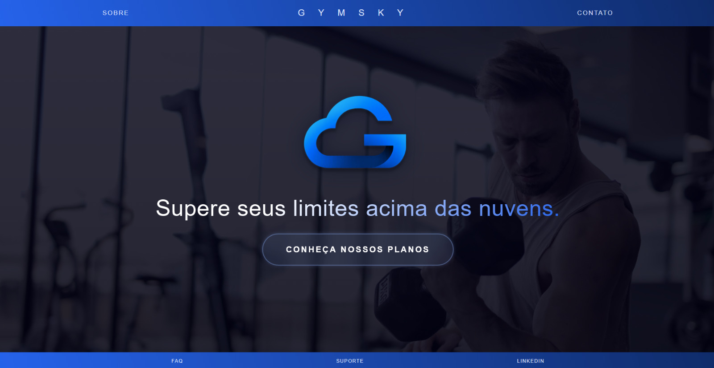

# GymSky

O GymSky é um projeto de landing page para uma academia hipotética, desenvolvido com um conceito visual moderno e focado em tons de azul e preto. O foco foi aprender e reforçar técnicas de aprendizado web, integrando design de interface no Figma com a implementação em código (HTML5 e CSS3).

## Tecnologias Utilizadas

* **HTML5:** Estrutura da página
* **CSS3:** Estilização avançada com Flexbox, efeitos de transparência (Glassmorphism), gradientes de texto e sombras personalizadas
* **Figma:** Prototipagem e definição da identidade visual

## Identidade Visual e Design

* **Paleta de Cores:** Tons contrastantes de azul escuro e azul claro para destaque dos diferentes elementos da página
* **Efeito de Vidro (Glassmorphism):** Aplicado no botão principal de planos da academia, com fundo translúcido e desfoque (backdrop-filter)
* **Logotipo:** Fusão conceitual entre nuvem e a inicial da marca

## Como Executar Localmente

Clone o repositório ou baixe os arquivos para uma pasta local:

'git clone https://github.com/arthurabarbosa/Gym-Sky.git'

Abra a pasta do projeto no VS Code e utilize a extensão Live Server, clicando com o botão direito no arquivo 'index.html' e selecionando "Open with Live Server".
